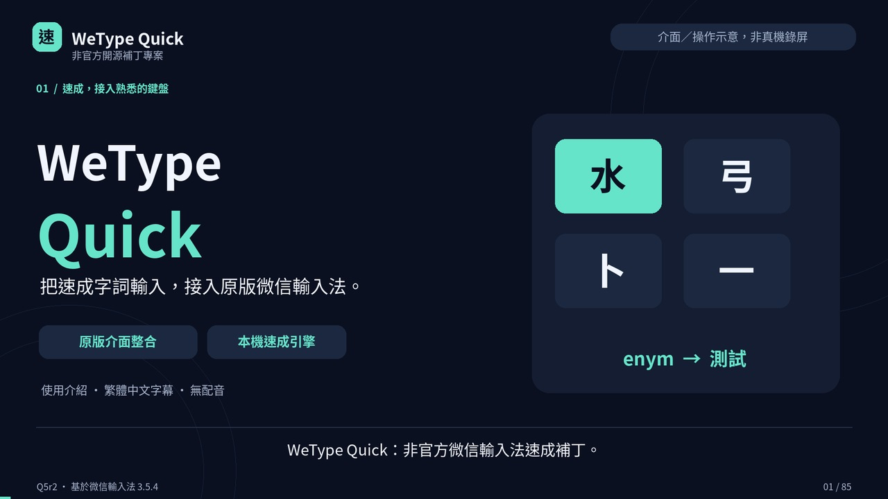

# WeType Quick · 非官方速成補丁

繁體中文 · [简体中文](docs/README.zh-CN.md) · [English](docs/README.en.md)

為 Android 微信輸入法加入香港常用速成輸入的實驗性原始碼與補丁工具。
新增引擎提供繁體字詞、連續輸入、本機排序，以及原版鍵盤介面的接駁。

本專案非官方，與騰訊／微信輸入法沒有隸屬或背書關係。開源授權只適用於
本倉庫自行編寫的程式與各自授權的第三方資料，不涵蓋原版程式、商標、素材或語音服務。

> v0.1.0 是本專案的第一個原始碼版本；支援的原版微信輸入法版本是 3.5.4。
> 發布內容不包含原版或修改版 APK。你須自行取得有權使用的指定原版，在本機重建。

## 介紹影片

[](docs/media/intro.zh-Hant.mp4)

[播放／下載影片](docs/media/intro.zh-Hant.mp4) · [繁中字幕](docs/media/intro.zh-Hant.srt) · [简中字幕](docs/media/intro.zh-Hans.srt) · [English subtitles](docs/media/intro.en.srt)

85 秒原創操作示意，並非手機實錄。影片不代表完整 App、私隱或語音已完成實機驗證。

## 功能

- 倉頡首尾碼速成，17,213 個字、100,032 個繁體／廣東話詞
- 最多連續輸入 8 字／16 根；可用分詞鍵明確分段
- 接駁原版中文全鍵盤、候選列、展開字表和鍵盤選擇器
- 候選字根顯示於鍵盤上方組字區；選字後才提交到文字框
- 單字篩選、逐組載入候選；長按可本機固定、取消固定或隱藏候選
- 本機選字學習；依有效輸入欄位的密碼／禁止個人化規則停用學習
- 原版「清除個人詞典」接駁至速成紀錄清除
- 藍牙耳機已連接時，向該次語音錄音器提出手機內置咪偏好

這份字詞庫的字形和排序不保證與 Gboard 或其他速成輸入法一致。

## 取得原始碼

在 GitHub 的 Releases 取得標記為 `v0.1.0` 的原始碼／補丁壓縮檔及 `SHA256SUMS`，
或直接下載此標籤的原始碼。不要將第三方提供的 APK 視為本專案認可的發行檔。
介紹影片 `wetype-quick-intro.zh-Hant.mp4` 隨同版本 Release 提供，另附三語字幕。影片只作功能和操作說明；示意畫面不等於手機實錄或驗證證據。

## 相容性

- 只接受原版 **3.5.4**，224,668,031 bytes
- 原版 SHA-256：`c036f49444b3230fc2fc7c119ae79f32b33766374fd5dc6d48246dea378ff889`
- 本機輸出標示 `3.5.4-quick.0.1.0`，versionCode 57207；不是新的騰訊官方版本
- 新增 DEX 以 API 24 為最低目標；這不是所有 Android 7+ 裝置都相容的保證
- 其他版本、拆分 APK、重新打包的原版，均會因雜湊不符而拒絕建置

## 本機重建

需要 Python 3.10+、Java 21、curl，以及足夠儲存空間。Linux 已測試；Windows／macOS 尚未實測。
建置工具會從官方專案／Maven 下載，按固定 SHA-256 驗證；不會下載原版 APK。
第一次下載工具和測試依賴需要網絡。

```sh
python3 scripts/build_local.py /absolute/path/to/original-3.5.4.apk
```

Windows 原生可嘗試 `py -3 scripts/build_local.py "C:\path\original-3.5.4.apk"`；此路徑尚未在 Windows 驗證，不需 WSL。詳見建置指南。

輸出為 `.local/build/wetype-quick-0.1.0-local-unsigned.apk`，並附本機結構檢查報告。
工具不會安裝、執行、上傳或簽署原版／修改版 App，不會建立或儲存你的簽署金鑰。
進階測試、簽署及安裝步驟見 [BUILD.md](docs/BUILD.md)。

建置只支援指定原版；不要略過雜湊檢查或把其他版本當作相同來源。
修改、使用及散布可能受當地法律與原版條款限制。只發布補丁不等於自動取得任何權利。

## 安裝與使用

1. 先閱讀 [建置、簽署及安裝](docs/BUILD.md)，自行保管簽署金鑰。
2. 用 Android 系統安裝你自行簽署的本機產物，再到系統輸入法設定啟用它。
3. 在原版鍵盤／輸入方式選擇頁選「速成」。選回其他模式可回到原版後端。
4. 試輸入 `enym`（水弓卜一），候選包括「測試」；選字後才會寫入文字框。

重新簽署的 App 無法直接更新騰訊原版，同套件名稱也不能與原版並存。
解除安裝可能永久刪除 App 資料；先備份，切勿為了解決簽章衝突而盲目解除安裝。
你自己的金鑰也不能更新以別人的金鑰簽署的實驗版。

## 私隱、語音與已知限制

請閱讀[完整私隱說明](PRIVACY.md)，包括本機紀錄、清除方式及原版仍保留的資料路徑。

新增速成引擎沒有網絡功能，字詞、排序、固定／隱藏紀錄在本機處理。
部分候選／推薦入口已有攔截，但原版 App 的全部記錄及網絡路徑未經完整審計；
不能由此宣稱整個 App 完全離線、不會上傳或適合處理敏感資料。

語音沿用原版路徑。本機補丁不提供語音服務授權；原版離線 ASR 的騰訊簽章檢查保留。
重新簽署可能令受檢查的離線資源無法使用。手機咪偏好可被 Android／廠商忽略，
也不保證線上或離線語音可用、識別品質或實際錄音路由。

上滑清除只清除游標前文字並保留游標後文字；無法確認完整位置或字素邊界時拒絕清正文。
這條速成路徑不保存整段刪除內容，也不提供原版下滑撤回。
完整 App、所有原版功能、廠商音訊系統及每一款手機仍需實機驗證。

測試範圍及結果見 [TESTING.md](docs/TESTING.md)。通過元件／結構測試不等於整機驗證。

## 貢獻與問題回報

請先閱讀 [CONTRIBUTING.md](CONTRIBUTING.md)。回報時提供本專案版本、Android 版本、
裝置型號及不含私人內容的重現步驟。請勿上傳 APK、反編譯碼、私人輸入內容、
簽署金鑰、帳號資訊或完整未檢查的系統日誌。

## 自願支持

如果這些開源工具對你有幫助，歡迎自願支持開發與維護。支持完全自願，
不是購買微信輸入法或取得其授權，也不提供騰訊官方服務。目前尚未設定收款連結。

## 授權與致謝

新增程式採 [MIT](LICENSE)。字詞資料分別使用 MIT、CC BY 4.0 及 Apache 2.0 授權，
完整來源、修改方式與授權文字見 [NOTICE.md](NOTICE.md) 和
[第三方聲明](quick-engine/THIRD_PARTY_NOTICES.md)。
感謝 Cangjie-system、CanCLID / Rime Cantonese、OpenVanilla / McBopomofo、OpenCC 及各位貢獻者。
